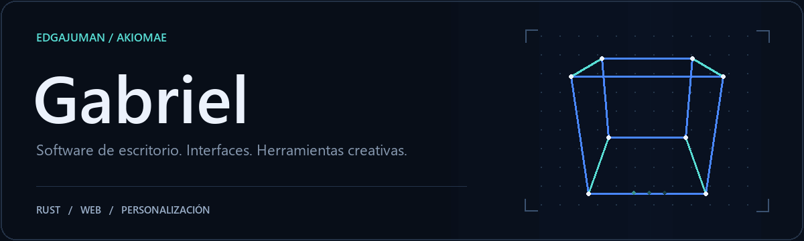
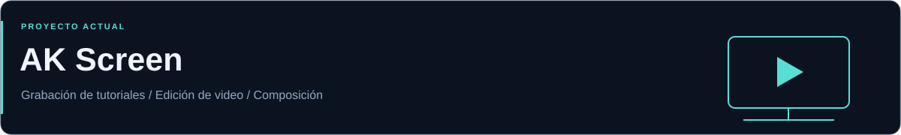
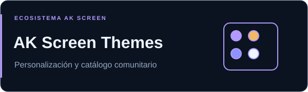
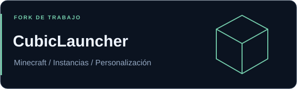
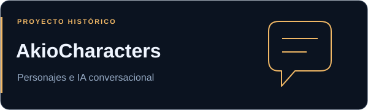
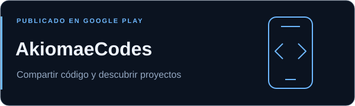
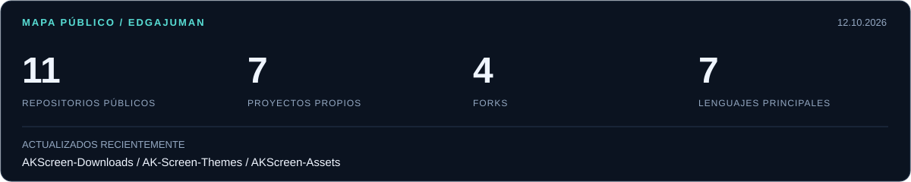

<picture>
  <source media="(prefers-reduced-motion: reduce)" srcset="./assets/hero-static.svg">
  
</picture>

  <a href="#proyectos">Proyectos</a> &nbsp; / &nbsp;
  <a href="#tecnologias">Tecnologías</a> &nbsp; / &nbsp;
  <a href="#actividad">Actividad pública</a> &nbsp; / &nbsp;
  <a href="#contacto">Contacto</a>

Soy **Gabriel**, también conocido como **Edgajuman**. Desarrollo proyectos bajo el nombre **Akiomae**, con interés en las aplicaciones de escritorio, las interfaces personalizables y las herramientas para crear contenido.

Mi trabajo actual se centra en **AK Screen**: grabar procesos del escritorio, convertirlos en tutoriales y editarlos con control sobre cámara, cursor, texto y audio.

## Proyectos destacados

### AK Screen

Aplicación de escritorio para grabar tutoriales y editar video. Captura de pantalla y audio, cursor simulado, cámara animada, texto editable, subtítulos locales y composición por capas. Proyectos y recursos se guardan en el dispositivo.

**Rust · Windows / Linux / macOS · GitHub Actions**

[Descargar](https://github.com/Edgajuman/AKScreen-Downloads/releases/latest) · [Funciones y primeros pasos](https://github.com/Edgajuman/AKScreen-Downloads/blob/main/docs/PRIMEROS-PASOS.md) · [Historial de versiones](https://github.com/Edgajuman/AKScreen-Downloads/releases)

Ver el editor en uso

 

Descargas y documentación públicas. El código fuente de AK Screen se administra en un repositorio privado.

 

<table>
  <tr>
    <td width="50%" valign="top">
      
      <h3>AK Screen Themes</h3>
      
Catálogo de temas con vistas previas, paquetes verificados y publicación automática. Colores, iconos, fuentes, fondos y disposición del editor.

      
<strong>Python · SVG · Estilos nativos</strong>

      
<a href="https://edgajuman.github.io/AK-Screen-Themes/">Explorar catálogo</a> · <a href="https://github.com/Edgajuman/AK-Screen-Themes">Crear un tema</a>

    </td>
    <td width="50%" valign="top">
      
      <h3>CubicLauncher</h3>
      
Launcher de Minecraft Java con gestión de instancias, versiones, mods y personalización. Mi repositorio es un fork de trabajo del proyecto de CubicLauncherDevs.

      
<strong>Rust · Tauri 2 · SvelteKit</strong>

      
<a href="https://github.com/Edgajuman/CubicLauncher">Mi fork</a> · <a href="https://github.com/CubicLauncherDevs/CubicLauncher">Proyecto original</a> · <a href="https://www.cubiclauncher.org/">Sitio</a>

    </td>
  </tr>
  <tr>
    <td width="50%" valign="top">
      
      <h3>AkioCharacters</h3>
      
Proyecto histórico para crear, compartir y conversar con personajes de IA. El servicio terminó; su código está disponible para aprendizaje y experimentación.

      
<strong>PHP · JavaScript · CSS</strong>

      
<a href="https://github.com/Edgajuman/AkioCharacters">Explorar código</a> · <a href="https://github.com/Edgajuman/AkioCharacters#instalación-y-despliegue">Documentación</a>

    </td>
    <td width="50%" valign="top">
      
      <h3>AkiomaeCodes</h3>
      
Aplicación publicada bajo Akiomae para compartir conocimientos de programación, descubrir proyectos y aprender de otros creadores.

      
<strong>Aplicación publicada en Google Play</strong>

      
<a href="https://play.google.com/store/apps/details?id=akiomaecodes.appvgw">Ver aplicación</a>

    </td>
  </tr>
</table>

Más repositorios públicos

 

| Repositorio | Qué encontrarás | Tipo |
| :--- | :--- | :--- |
| [CubicLauncher Themes](https://github.com/Edgajuman/Themes) | Temas y recursos de personalización para CubicLauncher. | Fork de CubicLauncherDevs |
| [NakamaCDN](https://github.com/Edgajuman/NakamaCDN) | Servidor de distribución de recursos escrito en Go. | Fork de NakamaStream |
| [NakamaStream](https://github.com/Edgajuman/NakamaStream) | Código de una plataforma web con JavaScript y EJS. | Fork de NakamaStream |
| [edgabot.dog.api](https://github.com/Edgajuman/edgabot.dog.api) | Proyecto web de imágenes aleatorias de perros. | Proyecto propio |

Los proyectos y forks conservan sus respectivas licencias y atribuciones.

## Tecnologías en mis proyectos

| Área | Tecnologías |
| :--- | :--- |
| Escritorio | Rust, Tauri, Python |
| Interfaces web | TypeScript, JavaScript, SvelteKit, HTML y CSS |
| Servicios y proyectos web | PHP, Go |
| Recursos e interfaces | SVG, fuentes locales, temas y animación |
| Desarrollo y distribución | Git, GitHub Actions, releases multiplataforma |

## Mapa de proyectos públicos

<picture>
  <source media="(prefers-color-scheme: dark)" srcset="./assets/activity-dark.svg">
  <source media="(prefers-color-scheme: light)" srcset="./assets/activity-light.svg">
  
</picture>

Resumen actualizado semanalmente mediante GitHub Actions. Las cifras excluyen este repositorio de perfil. Los lenguajes corresponden a los principales que GitHub detecta en cada repositorio.

## Contacto y colaboración

Puedes encontrarme en [GitHub](https://github.com/Edgajuman). Para propuestas, errores o mejoras, abre un issue en el repositorio correspondiente. Para aportar temas de AK Screen, envía un pull request al [catálogo de la comunidad](https://github.com/Edgajuman/AK-Screen-Themes).

  <a href="https://github.com/Edgajuman?tab=repositories">Todos los repositorios</a> &nbsp; / &nbsp;
  <a href="https://github.com/Edgajuman/AKScreen-Downloads/releases">Descargas de AK Screen</a> &nbsp; / &nbsp;
  <a href="https://play.google.com/store/apps/details?id=akiomaecodes.appvgw">AkiomaeCodes</a>

